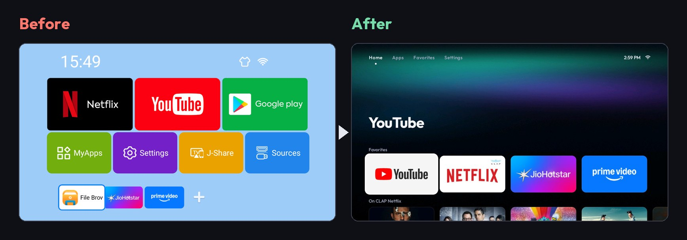
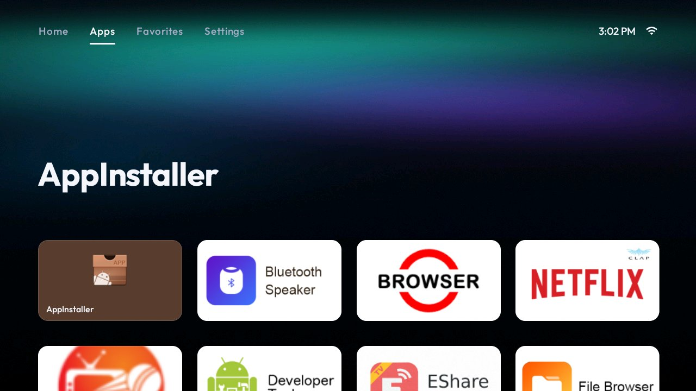
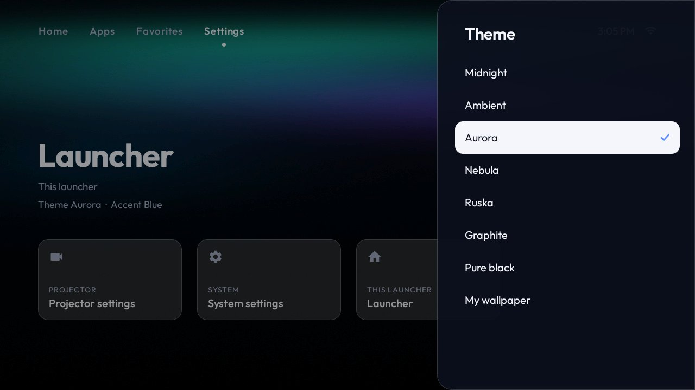
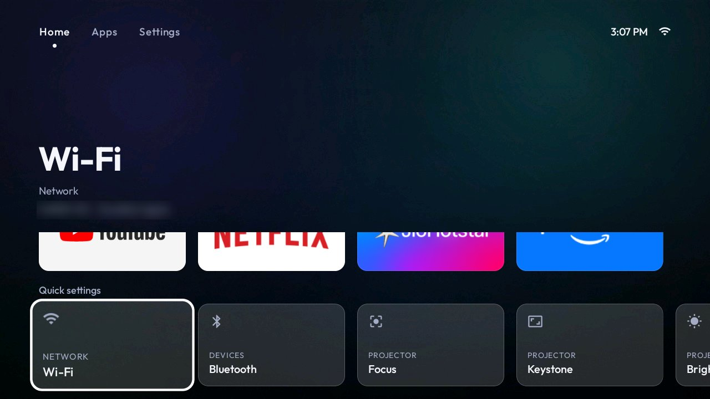

<p align="center">
  
</p>

<h1 align="center">Clean Beam</h1>

<p align="center">
  <b>Your projector, minus the junk.</b><br>
  Debloat an Android projector over Wi-Fi, replace its home screen with a clean launcher,
  and control it from your phone. No root, nothing uninstalled, one-line restore.
</p>

<p align="center">
  <a href="https://github.com/harshonedev/cleanbeam/releases/latest">Download</a> ·
  <a href="#quick-start">Quick start</a> ·
  <a href="#what-you-get">What you get</a> ·
  <a href="#supported-projectors">Supported projectors</a> ·
  <a href="docs/guides/README.md">Guides</a> ·
  <a href="PROMPTS.md">AI prompts</a> ·
  <a href="CONTRIBUTING.md">Add your projector</a>
</p>

---

Cheap Android projectors ship with ad pushers, telemetry, forced updates, third-party app stores
and a slow, cluttered launcher. Clean Beam fixes that with standard Android tooling (ADB), from a
Mac, Linux or Windows computer on the same Wi-Fi:

| Step | What happens |
|---|---|
| **Back up** | The installed packages, what was already off, the Home screen and the screensaver are saved on your computer. |
| **Debloat** | The firmware's junk is turned off with `pm disable-user`. Nothing is uninstalled, so `tools/restore.sh` brings every package back. |
| **Launcher** | A fast home screen made for a projector and a D-pad: themes, a streaming catalogue, quick projector controls, a clock screensaver. |
| **Phone remote** | Control the projector from your phone over Wi-Fi or Bluetooth: D-pad, keyboard, touchpad, apps, focus and keystone. |

Clean Beam is **projector-first**. It knows about focus, keystone, projection mode and vendor input
screens, and each projector gets its own tested list. The launcher and the catalogue also run on
Android TVs and TV boxes. The phone remote only works where network ADB skips the authorisation
handshake (`ro.adb.secure` is `0` or empty). Certified Google TV devices usually ask for that
handshake, so the remote cannot press keys there.

> Clean Beam is heavily inspired by [cleanyourtv](https://github.com/Gathin23/cleanyourtv), which does
> the same for Android TVs. If you have a TV rather than a projector, start there.

## Quick start

You need a computer on the same Wi-Fi as the projector, `adb`, `git`, and about 20 minutes.
The launcher needs **Android 9 or newer**.
**Signed APKs** for the launcher (Full and Lite, version 0.1.0), the receiver and the Android phone
app are on [Releases](https://github.com/harshonedev/cleanbeam/releases/latest), so you don't need
to build anything.

| | Where | What to do |
|---|---|---|
| **1** | **Projector** | Settings → Device Preferences → About → press OK on **Build** 7 times. Back → Developer options → turn on **USB debugging** (and **Network / ADB debugging** if it's there). |
| **2** | **Computer** | Install `adb` and `git` ([Mac, Linux, Windows guide](docs/guides/01-prepare-your-computer.md)), then `git clone https://github.com/harshonedev/cleanbeam && cd cleanbeam` |
| **3** | **Connect** | `adb connect <projector-ip>:5555`. The EGate Atom 3X, and many others, use **3333** instead. Accept "Allow USB debugging?" on the projector. `adb devices` should list it as `device`. ([Help](docs/guides/02-connect-your-projector.md)) |
| **4** | **Debloat** | On the Atom 3X: `DRY_RUN=1 tools/debloat.sh models/egate-atom-3x/debloat.txt` prints what it would turn off and changes nothing. Drop `DRY_RUN=1` to apply it. You should see `backup: backups/...`, then `OK`, `SKIP` or `WARN` for each package. Another projector: `tools/scan.sh` writes a report to `scans/` and changes nothing — build a list from the [debloat guide](docs/guides/03-debloat.md) before disabling anything. |
| **5** | **Launcher** | Install the launcher and make it Home. ([Guide](docs/guides/04-launcher.md)) |
| **6** | **Remote** | Install the receiver on the projector and the app on your Android phone, then pair with the 6-digit code. ([Guide](docs/guides/05-phone-remote.md)) |

Would you rather have an AI coding assistant (Claude Code, Codex, Gemini CLI) do it, checking each
step with screenshots from the projector? Open this folder in it and paste a prompt from
[`PROMPTS.md`](PROMPTS.md).

Changed your mind? `tools/restore.sh` puts everything back ([guide](docs/guides/06-restore.md)).

## What you get

### A launcher built for a projector

The Full edition has four tabs (**Home**, **Apps**, **Favorites**, **Settings**). Lite has three
(**Home**, **Apps**, **Settings**): favourites sit on Home, and there is no Favorites tab. Either
way the D-pad drives everything. A big title names whatever has focus, the clock and Wi-Fi sit
top right, and the font is [Outfit](https://fonts.google.com/specimen/Outfit).

| | |
|---|---|
|  |  |
| *Apps: every installed app, big enough to read from the sofa* | *Settings: phone remote, Wi-Fi, Bluetooth, Focus, Keystone, Brightness, Projection, Input source* |

### Themes

Full has eight. Lite has the same list without **Ambient** (seven). Pick one from **Settings →
Launcher → Theme**. It applies instantly behind the menu, so the list doubles as a preview.
Ambient (Full only) is the only theme that moves: the focused title's artwork washes over the room
in its colour. **My wallpaper** shows your own pictures, a new one every half hour.


| | |
|---|---|
|  |  |
| *Theme picker* | *Launcher settings: accent colour, picture dim, 24-hour clock, region, TMDB token, keep Wi-Fi awake* |

### A streaming catalogue (Full edition)

The Home tab shows a row of posters for each streaming app you have installed (Netflix, Prime
Video, JioHotstar, Disney+, Zee5, SonyLIV, Apple TV, MX Player, Crunchyroll, MUBI and more). Posters
and titles come from [TMDB](https://www.themoviedb.org/), filtered by your region. Picking a title
opens it **directly in its app** when a deep link exists, or that app's search otherwise.

The catalogue needs a free TMDB access token of your own: paste it in **Settings → Launcher → TMDB
access token**, or push it from your computer ([how](docs/guides/04-launcher.md#the-streaming-catalogue)).
Without one, the launcher works fine and simply leaves the catalogue out. The services it knows are
listed in
[`Services.kt`](launcher/app/src/full/java/com/cleanbeam/launcher/catalog/Services.kt).
YouTube is left out on purpose: its catalogue is uploads, not film and series releases.

### A Lite edition for weak projectors

`lite` is the same launcher without the catalogue: no TMDB, no image downloads, and no `INTERNET`
permission at all. Its Home tab is your favourite apps plus a **Quick settings** row (Wi-Fi,
Bluetooth, Focus, Keystone, Brightness, Input source, Launcher). It's ideal for 1 GB boxes, or if
you just want a clean app launcher. Both editions use the package `com.cleanbeam.launcher`, so
installing one over the other keeps your theme, favourites and settings.

| | |
|---|---|
|  |  |
| *Lite Home, Nebula theme* | *Quick settings: projector controls one press away* |

### A clock screensaver

A thin clock and the date over your own picture, dimmed so nothing burns in. It replaces the ad
screensavers many projectors ship with.


### A phone remote


Lost the IR remote, or tired of typing passwords with a D-pad? **Clean Beam Remote** is an Android
phone app plus a small receiver on the projector. The iOS project is the same Flutter code; it is
not on Releases yet.

- **Remote:** D-pad with press-and-hold, Back, Home, Menu, volume, media keys, power menu.
- **Quick settings:** Input source, Wi-Fi, Bluetooth, Focus, Keystone, Brightness, Projection, projector settings, system settings. Each one shows up only when the projector has it.
- **Type:** a live keyboard. Every key goes straight to the focused field, emoji and Hindi included, and you can paste from your phone.
- **Apps:** every app on the projector with its icon. Tap to open, long-press to pin.
- **Touchpad:** drag to move a mouse pointer, tap to click, two fingers to scroll.
- **Wi-Fi and Bluetooth:** it connects over both and prefers Wi-Fi, so it keeps working when the projector drops off Wi-Fi.


Pair once by scanning the QR code on the projector or typing its 6-digit code:


## Supported projectors

| Projector | Android | ADB port | Debloat | Launcher | Remote | Folder |
|---|---|---|---|---|---|---|
| EGate Atom 3X | 13 | 3333 | ✅ tested | ✅ Full + Lite | ✅ Wi-Fi + BLE | [`models/egate-atom-3x`](models/egate-atom-3x/) |

**Your projector isn't listed?** The launcher still installs on Android 9 or newer. The remote
still needs network ADB that skips authorisation, which is how most uncertified Android projectors
ship. Run `tools/scan.sh`, build a list with the [debloat guide](docs/guides/03-debloat.md) (or the
"new projector" prompt in [`PROMPTS.md`](PROMPTS.md)), and send it as a pull request
([`CONTRIBUTING.md`](CONTRIBUTING.md)). Every list in `models/` came from someone's real projector.
Only list packages you actually tried, and mark guesses with `# untested:`.

[cleanyourtv's `examples/`](https://github.com/Gathin23/cleanyourtv/tree/main/examples) has tested
lists for several projectors we don't have yet (Magcubic HY300 Pro, HY320, Wanbo X5 Pro, XGIMI,
Nebula, Formovie). They're a good starting point for your `models/` folder, and they're MIT
licensed: keep their notice when you copy one.

## Guides

| Guide | |
|---|---|
| [1. Prepare your computer](docs/guides/01-prepare-your-computer.md) | `adb`, `git` and (to build) JDK 17 on **macOS, Linux and Windows** |
| [2. Connect to your projector](docs/guides/02-connect-your-projector.md) | Developer options, finding the IP, ports 5555 / 3333, wireless debugging |
| [3. Debloat](docs/guides/03-debloat.md) | Scan, build a list, apply it, and what never to disable |
| [4. Launcher](docs/guides/04-launcher.md) | Full vs Lite, install, make it Home, themes, wallpapers, catalogue, screensaver |
| [5. Phone remote](docs/guides/05-phone-remote.md) | Receiver, phone app, pairing, Wi-Fi and Bluetooth |
| [6. Restore](docs/guides/06-restore.md) | Undo everything, or one piece |
| [Troubleshooting](docs/guides/troubleshooting.md) | Black screen after reboot, Home snaps back, "No route to host", and more |

## Repository layout

```
launcher/   Android TV launcher (Kotlin). Flavors: full (catalogue) and lite.
remote/     Phone remote: phone/ (Flutter app), receiver/ (projector service), PROTOCOL.md.
models/     One folder per projector: debloat.txt, device.json, README.md.
tools/      scan.sh, debloat.sh, restore.sh, push-wallpapers.sh, install-remote.sh, wsctl.mjs.
docs/       Guides, screenshots, design notes.
PROMPTS.md  Prompts for AI coding assistants.
```

Developer notes for the launcher's source layout and the remote's wire protocol live in
[`docs/guides/04-launcher.md`](docs/guides/04-launcher.md#building-from-source) and
[`remote/README.md`](remote/README.md).

## Limits

- **One projector is tested end to end.** Debloat, both launcher editions and the phone remote were run on the EGate Atom 3X (Android 13, ADB on port 3333).
- **The phone remote needs open network ADB.** It injects keys through the projector's own `adbd` on localhost. That works when `adb shell getprop ro.adb.secure` prints `0` or nothing. When it prints `1`, the receiver cannot press keys, type or open apps.
- **Sleep cannot be undone from the phone.** On the boards this was tried on, sleep suspends Wi-Fi and Bluetooth. Wake the projector with the IR remote or the power button.
- **The phone app is Android-only for now.** There is no iOS build on Releases.
- **Lite stays offline.** No catalogue, no Ambient theme, no `INTERNET` permission, and no Favorites tab.

## Safety

- **Nothing is uninstalled.** Every package is disabled for user 0 and comes back with `pm enable`.
- `tools/debloat.sh` **refuses** lists that touch core Android (package installer, permission controller, System UI, Settings, Play Store and Services, keyboards), and **skips** the app that is currently Home.
- Every run writes a backup to `backups/` first, and `tools/restore.sh` replays it.
- Network ADB on these projectors usually has **no authorisation**: anyone on your Wi-Fi can get a shell. Only leave it on if you trust your network ([details](docs/guides/02-connect-your-projector.md#security)).

## Credits

- [cleanyourtv](https://github.com/Gathin23/cleanyourtv) by Gathin and contributors: the idea, the per-model list format and the safety rules (MIT).
- [Outfit](https://fonts.google.com/specimen/Outfit) font (SIL OFL 1.1, see `launcher/FONT-LICENSE-OFL.txt`).
- Catalogue data from [TMDB](https://www.themoviedb.org/). This product uses the TMDB API but is not endorsed or certified by TMDB. Streaming availability from JustWatch.

## License

[MIT](LICENSE).

A bad result, a question, or a projector to add: open an [issue](https://github.com/harshonedev/cleanbeam/issues). A tested model folder is a pull request ([how](CONTRIBUTING.md)).
