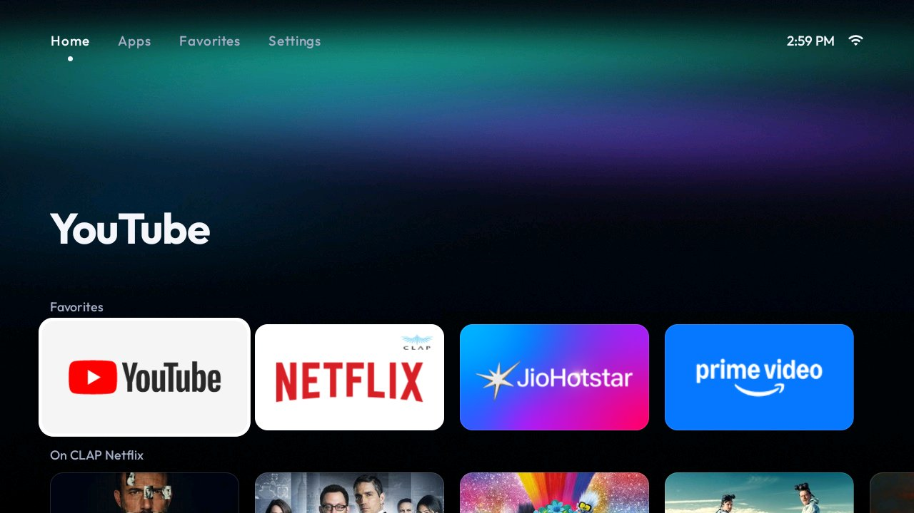
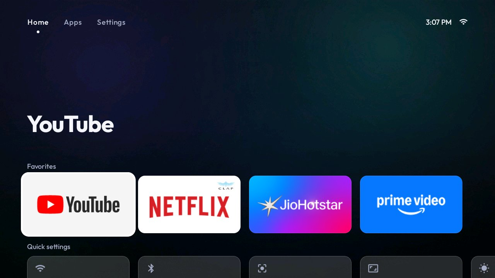
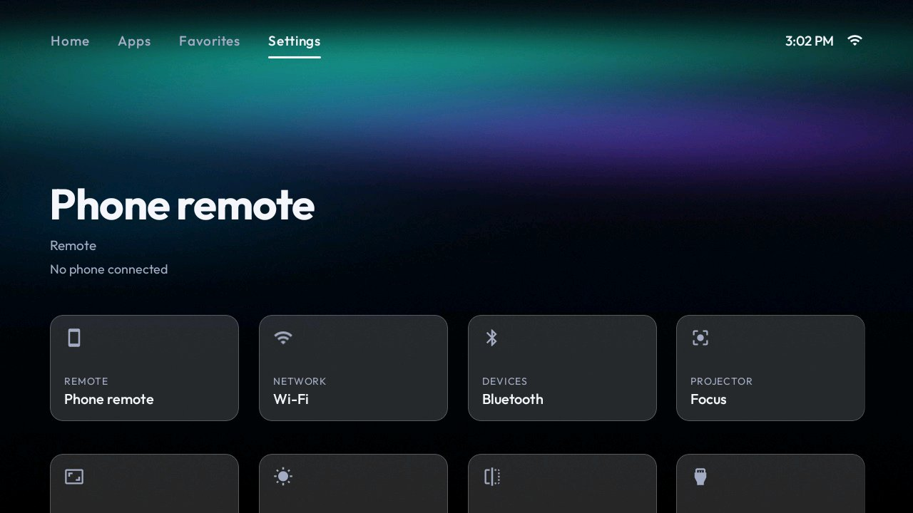
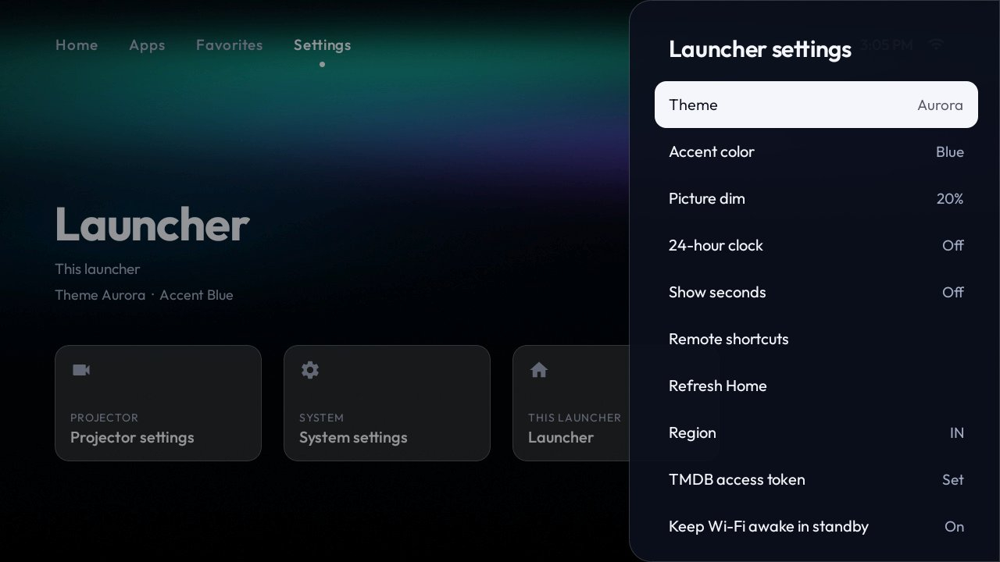
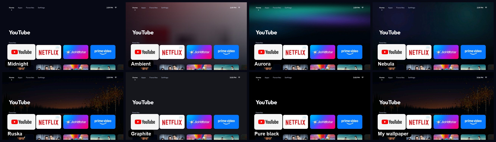
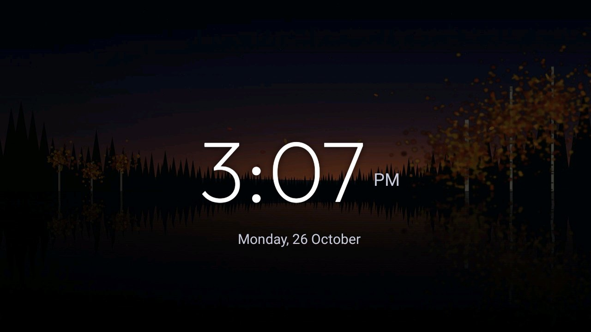

# 4. Launcher



The launcher replaces the projector's home screen. It's a native Kotlin app built for a D-pad and a
720p or 1080p picture, and it stays light on 1 GB boxes.

## Full or Lite?

| | **Full** | **Lite** |
|---|---|---|
| Tabs | Home, Apps, Favorites, Settings | Home, Apps, Settings |
| Home tab | Favourite apps, then a poster row per streaming app (TMDB) | Favourite apps, then Quick settings (Wi-Fi, Bluetooth, Focus, Keystone, Brightness, Input source, Launcher) |
| Themes | 8, including **Ambient** (moving artwork glow) | 7 (no Ambient) |
| Internet permission | Yes, for posters and titles | **None** |
| TMDB token | Needed for the catalogue | Not used |
| Best for | Watching: the catalogue opens titles straight in Netflix, Prime and the rest | Weak boxes, or just a clean, fast app launcher |

Both use the package `com.cleanbeam.launcher`. Installing one over the other keeps your theme,
favourites and settings.



## Install

### From a release APK

Download it from [Releases](https://github.com/harshonedev/cleanbeam/releases/latest), then:

```sh
adb install -r cleanbeam-launcher-full-0.1.0.apk      # or cleanbeam-launcher-lite-0.1.0.apk
```

### Building from source

```sh
cd launcher
./gradlew :app:assembleFullDebug          # or :app:assembleLiteDebug   (Windows: gradlew.bat ...)
adb install -r app/build/outputs/apk/full/debug/app-full-debug.apk
cd ..
```

Run the unit tests with `./gradlew :app:testFullDebugUnitTest :app:testLiteDebugUnitTest`.

If `adb install` hangs (Android 14 sometimes waits for an on-screen confirmation), push the APK and
install it from the shell instead:

```sh
adb push app-full-debug.apk /data/local/tmp/cb.apk
adb shell pm install -r /data/local/tmp/cb.apk
```

## Make it Home

Press Home on the remote. Most projectors ask which launcher to use: pick **Clean Beam** and choose
**Always**. Or set it from the computer:

```sh
adb shell cmd package set-home-activity com.cleanbeam.launcher/.LauncherActivity
```

Some firmware ignores that and picks Home its own way. For example, EGate/Jixin boards read a
system property that the stock launcher keeps rewriting. The model's `README.md` in `models/` says
what that firmware needs. If Home keeps snapping back to stock after a reboot, see
[Troubleshooting](troubleshooting.md#home-snaps-back-to-the-stock-launcher).

Keep the stock launcher installed (don't put it in your debloat list). It's your fallback.

### Recommended extras

```sh
# "Last opened" on the Home hero, and a list of recent apps
adb shell appops set com.cleanbeam.launcher GET_USAGE_STATS allow

# Let the launcher put its clock screensaver back when firmware resets it at boot
adb shell pm grant com.cleanbeam.launcher android.permission.WRITE_SECURE_SETTINGS
```

## Using it

| Key | Does |
|---|---|
| D-pad | Move. Up from the first row reaches the tabs |
| OK | Open |
| Hold OK on an app | Pin to / unpin from favourites, move left / right, **assign remote button**, app info |
| Back | Close a menu, or go back to Home |

**Remote button shortcuts:** hold OK on an app → *Assign remote button* → press any spare button on
the IR remote (a colour key, or a "Netflix" key you never use). From then on that button opens the
app from anywhere on Home. Direction, OK, Back and Home are reserved. Manage them under Settings →
Launcher → Remote shortcuts.

**Settings tab:** Phone remote, Wi-Fi, Bluetooth, Focus, Keystone, Brightness, Projection, Input
source, Projector settings, System settings and **Launcher**. The projector-specific tiles appear only
when the projector has a screen for them.



**Launcher settings** (Settings → Launcher): theme, accent colour, picture dim, 24-hour clock, show
seconds, remote shortcuts, catalogue region and TMDB token (Full), and keep Wi-Fi awake in standby.



## Themes

Settings → Launcher → **Theme**. The theme applies as you move through the list.



| Theme | Look |
|---|---|
| Midnight | Deep navy, solid cards (default) |
| Ambient | *Full only.* The focused title's artwork washes over a time-of-day sky. The only moving theme |
| Aurora | Northern-lights picture, frosted-glass cards |
| Nebula | Soft nebula picture, glass cards |
| Ruska | Autumn lake at dusk, glass cards |
| Graphite | Dark grey, glass cards |
| Pure black | True black: best contrast on a projector in a dark room |
| My wallpaper | Your own pictures, a new one every half hour, glass cards |

**Picture dim** darkens any picture theme so text stays readable.

## Your own wallpapers

```sh
tools/push-wallpapers.sh ~/Pictures/beach.jpg ~/Pictures/city.png
tools/push-wallpapers.sh -c ~/Pictures/new/*.jpg        # -c empties the folder first
```

Then pick the **My wallpaper** theme. The screensaver uses the same pictures.

- JPG, PNG or WebP. About 1920×1080 is ideal: the projector decodes each picture itself, and many
  have 1 GB of RAM.
- The pictures land in `/sdcard/Android/data/com.cleanbeam.launcher/files/wallpapers/`.
- If you copy pictures with plain `adb push` instead of the script, make the folder readable or the
  launcher can't see them:
  `adb shell chmod 2775 /sdcard/Android/data/com.cleanbeam.launcher/files/wallpapers`

## The streaming catalogue

*Full edition.* The Home tab shows a poster row per streaming app you have installed. Titles come
from TMDB, filtered by your region, and picking one opens it in its app.

1. Create a free account at [themoviedb.org](https://www.themoviedb.org/signup).
2. Go to Settings → **API** → request an API key (choose "Developer", personal use).
3. Copy the **API Read Access Token**, the long one starting `eyJ`.
4. Give it to the launcher in one of two ways:
   - On the projector: Settings → Launcher → **TMDB access token**. Paste is easiest with the
     phone remote's **Type** sheet.
   - From the computer:
     ```sh
     printf '%s' 'eyJ...your token...' > tmdb.key
     adb push tmdb.key /sdcard/Android/data/com.cleanbeam.launcher/files/tmdb.key
     rm tmdb.key
     ```
5. Settings → Launcher → **Region**: pick your country so the rows match your apps.

Supported apps include Netflix, Prime Video, JioHotstar, Disney+, Zee5, SonyLIV, Apple TV, MX Player,
aha, Crunchyroll, MUBI, Hoichoi, Sun NXT and Lionsgate Play. To add one, see
`launcher/app/src/full/java/com/cleanbeam/launcher/catalog/Services.kt`.

Your token stays on your projector, so never commit it. Without a token the launcher works
normally and the Home tab shows only your favourites.

## Screensaver

The launcher includes a clock screensaver (a thin clock and the date over your wallpaper, dimmed).
Set it as the projector's screensaver:

```sh
adb shell settings put secure screensaver_components com.cleanbeam.launcher/com.cleanbeam.launcher.system.ClockDreamService
```



To preview it now: `adb shell service call dreams 1` starts it and `service call dreams 2` stops it.

Some firmware puts its own (ad) screensaver back at every boot. Disable the vendor screensaver
package in your debloat list, and grant `WRITE_SECURE_SETTINGS` as shown above so the launcher
re-asserts its clock whenever you return Home.

## Keep Wi-Fi awake in standby

On by default. It holds a Wi-Fi lock so the phone remote and ADB stay reachable while the picture is
off. It doesn't help when the projector truly sleeps (suspends): on most boards that turns Wi-Fi
off, and only the IR remote or the power button wakes it.

## Source layout

`launcher/app/src/main/java/com/cleanbeam/launcher/`, with flavor-only code under `src/full/` and
`src/lite/`:

| Package | What lives there |
|---|---|
| (root) | `LauncherActivity`, the one screen, and `Prefs` |
| `home` | The Home tab behind `HomeTab`/`HomeHost`: `CatalogHome` (full) or `LiteHome` (lite) |
| `catalog` | *Full only.* `Tmdb` client, `JustWatch` deep links, `Services`, `Title`/`HomeRow`, `Playback` |
| `apps` | Installed apps: `AppInfo`, `AppRepository` |
| `ui` | Adapters, focus-aware RecyclerViews, layout managers, `SidePanel` (every menu) |
| `graphics` | `Cards`, `Layers`, `Themes`, `Wallpaper`, `Backdrop`, `ImageLoader` |
| `settings` | Settings tab: `Tile`, `SystemShortcuts`, `VendorScreens`, `DeviceInfo` |
| `system` | Boot receiver, keep-alive service, clock dream, `RemoteLink` to the remote receiver |

Unit tests mirror the packages under `launcher/app/src/test/`. Release APKs measured 2026-10-23:
Full 1,571 KB, Lite 1,525 KB.

Next: [5. Phone remote](05-phone-remote.md)
