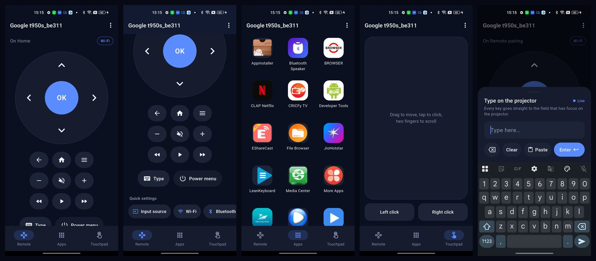
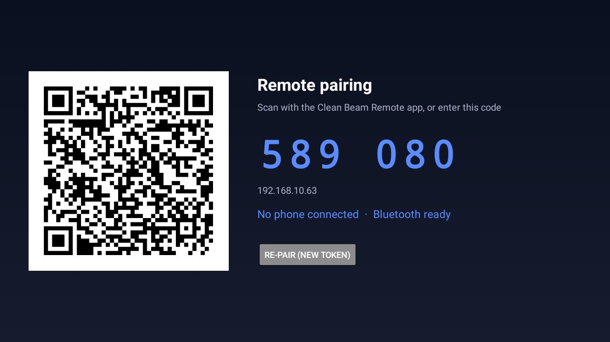

# 5. Phone remote


Two parts:

| Part | Runs on | Package |
|---|---|---|
| **Receiver** | the projector, as a background service listening on Wi-Fi (WebSocket) and Bluetooth LE | `com.cleanbeam.remote` |
| **Clean Beam Remote** | your phone. Android today; iOS builds from the same Flutter code later | `com.cleanbeam.phone` |



## Will it work on my projector?

The receiver presses keys by talking to the projector's own ADB service on `localhost`. That works
when network ADB doesn't ask for authorisation, which is how most uncertified Android projectors
ship. Check:

```sh
adb shell getprop ro.adb.secure          # 0 or empty: yes. 1: no (certified devices; see below)
adb shell getprop persist.adb.tcp.port   # 5555 or 3333 is ideal
```

On a locked-down, certified Android TV / Google TV device (`ro.adb.secure=1`), the receiver can't
press keys, type or open apps for you. Use the official Google TV remote there.

## 1. Install the receiver on the projector

From source (JDK 17):

```sh
tools/install-remote.sh --build          # builds, installs, grants permissions, starts it, opens pairing
```

From a release APK:

```sh
adb install -r cleanbeam-remote-receiver.apk
adb shell pm grant com.cleanbeam.remote android.permission.BLUETOOTH_CONNECT
adb shell pm grant com.cleanbeam.remote android.permission.BLUETOOTH_ADVERTISE
adb shell pm grant com.cleanbeam.remote android.permission.POST_NOTIFICATIONS
adb shell appops set com.cleanbeam.remote GET_USAGE_STATS allow
adb shell am start -n com.cleanbeam.remote/.PairingActivity
```

(If adb sees more than one device, `export ANDROID_SERIAL=<projector-ip>:<port>` first.)

The receiver starts on boot by itself. To open the pairing screen later, use **Settings → Phone
remote** in the Clean Beam launcher, or run the `am start` line above.

## 2. Install the app on your phone

From a release: copy `cleanbeam-remote-phone.apk` to the phone and open it. Allow "install unknown
apps" for your file manager or browser when asked.

From source (Flutter 3.41+, JDK 17), with the phone connected over USB and USB debugging on:

```sh
cd remote/phone
flutter pub get
(cd android && ./gradlew assembleDebug)     # Windows: android\gradlew.bat assembleDebug
adb -s <phone-serial> install -r build/app/outputs/flutter-apk/app-debug.apk
```

`adb devices` shows the phone's serial. Use `./gradlew` rather than `flutter build apk`: the
latter sometimes tries to download its own Gradle and fails.

## 3. Pair



The projector shows a **QR code** and a **6-digit code**. In the app, either:

- point the camera at the QR code, or
- tap **Enter the 6-digit code instead** and type the code. The phone must be on the same Wi-Fi.

The code works once, only while that screen is open, and five wrong tries cancel it. **Re-pair (new
token)** on the projector unpairs every phone.

The app asks for **Camera** (QR only) and **Nearby devices** (Bluetooth). Allow Nearby devices, or the
Bluetooth fallback won't work.

## Using it

| Screen | What it does |
|---|---|
| **Remote** | D-pad (hold to repeat), OK, Back, Home, Menu, volume, mute, rewind / play / fast-forward, **Type**, **Power menu** |
| **Quick settings** (scroll down on Remote) | Input source, Wi-Fi, Bluetooth, Focus, Keystone, Brightness, Projection, Projector settings, System settings. Only what the projector has |
| **Apps** | Every app on the projector with its icon. Tap to open, long-press to pin, pull to refresh |
| **Touchpad** | Drag to move a pointer, tap to click, two fingers to scroll, left and right click buttons |
| **Type** | Live keyboard: each key goes to the focused field. Backspace (hold to repeat), Clear, Paste from your phone, Enter |

The badge at the top right shows the link in use: **Wi-Fi** or **Bluetooth**. The app tries both and
prefers Wi-Fi. When it falls back to Bluetooth (stale IP, Wi-Fi off), it keeps retrying Wi-Fi and
switches back silently. Over Bluetooth the Apps grid shows letter tiles instead of icons.

When a phone is connected, the launcher's clock area shows **Phone remote connected**.

## Limits

- **It can't wake a sleeping projector.** On most boards sleep is a full suspend that turns Wi-Fi and
  Bluetooth off. Use the IR remote or the power button.
- **Focus and keystone** open the projector's own screens. They aren't keys.
- **Power menu** sends the vendor power key on Jixin boards, and a long press of the Android power key
  elsewhere.

## Uninstall

```sh
adb uninstall com.cleanbeam.remote        # on the projector; the helper dies at the next reboot
```

Nothing else on the projector changes. Developers: the wire protocol is in
[`remote/PROTOCOL.md`](../../remote/PROTOCOL.md), and build, test and Maestro flows are in
[`remote/README.md`](../../remote/README.md).

Next: [6. Restore](06-restore.md)
